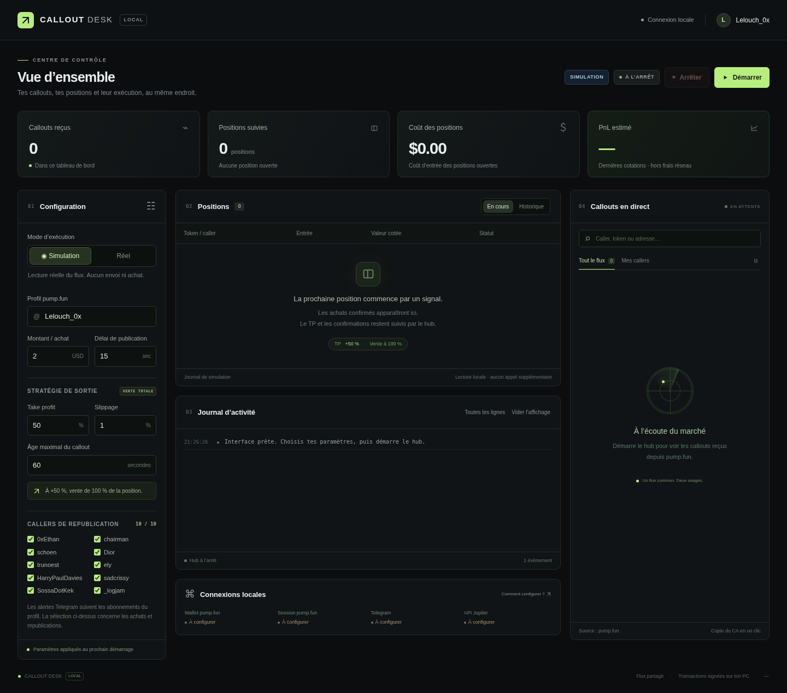

# Callout Desk — interface locale Windows



Le tableau de bord reprend la présentation sombre des captures : paramètres à gauche, positions et journal au centre, callouts à droite. Il pilote le hub existant avec un lecteur partagé. Il est accessible uniquement sur l’ordinateur qui le lance.

## Installation et lancement

1. Télécharger le ZIP actualisé de la branche GitHub.
2. Mettre à jour les dossiers `scripts` et `web`, les documents et `LANCER_INTERFACE.bat` dans ton installation existante. **Conserver le dossier `data`** avec ses fichiers de wallet/session et ses journaux. Les dossiers `data`, `scripts` et `web` doivent être au même niveau.
3. Arrêter l’ancien hub dans le terminal avant de démarrer via l’interface.
4. Dans la fenêtre CMD où `JUP_API_KEY` est déjà configurée :

```bat
py -m pip install -r requirements-repost.txt
py scripts\callout_dashboard.py
```

Le navigateur s’ouvre automatiquement. Garder le terminal ouvert. `LANCER_INTERFACE.bat` peut aussi lancer l’interface ; il hérite des variables de la fenêtre depuis laquelle il est exécuté. Un double-clic depuis l’Explorateur n’hérite pas d’une clé définie uniquement dans une autre fenêtre CMD : dans ce cas, utiliser la commande ci-dessus ou une variable d’environnement Windows persistante.

Aucune installation Node.js/npm n’est nécessaire. Le serveur est en Python et l’interface utilise des fichiers HTML/CSS/JS locaux. Pour choisir un autre port : `py scripts\callout_dashboard.py --port 8766`.

## Fonctionnement

- **Simulation** : flux public réel ; décisions d’achat/republication simulées, sans transaction, publication ou envoi Telegram.
- **Réel** : mêmes achats, republications et alertes Telegram que le hub existant. Le bouton indique « Démarrer en réel » ; aucun démarrage automatique à l’ouverture de la page.
- **Arrêter** : arrêt coopératif du processus lancé par cette interface, après les opérations en cours. Cela suspend aussi le suivi TP. Les tokens restent dans le wallet et les états dans le journal ; le démarrage suivant reprend ce journal. Ce bouton ne vend pas les positions.

Les changements de mode, profil, montant, délai, TP, slippage, âge maximal et sélection des callers sont appliqués au prochain démarrage. Arrêter le hub pour les modifier. Les paramètres non secrets sont mémorisés dans `data/dashboard/settings.json`.

Le mode réel utilise les fichiers `data/pump_wallet.txt`, `data/pump_token.txt`, la session Telegram existante et les variables de la fenêtre terminal. Les valeurs de clés ne sont ni demandées ni affichées dans le navigateur. L’indicateur « Disponible » constate une présence locale ; il ne valide pas un accès auprès du fournisseur. Si Telegram n’a jamais été connecté sur cet ordinateur, effectuer la première connexion dans le terminal avec le hub comme décrit dans [CALLOUT_HUB.md](CALLOUT_HUB.md).

## Données affichées

Le flux montre les callouts Solana déjà reçus par le lecteur public du hub, y compris les callers non sélectionnés. Aucun second lecteur pump.fun n’est créé pour l’interface. « Mes callers » filtre l’affichage selon la sélection des callers d’achat/republication. Les alertes Telegram continuent de suivre les abonnements du profil ; cliquer « Copier CA » copie uniquement l’adresse du token.

La pause du flux suspend **l’affichage** ; la détection et l’exécution continuent. La recherche filtre les callers, noms, symboles, commentaires et adresses. Les données du flux sont bornées aux 240 derniers callouts dans la page, avec un compteur d’événements de session.

Le tableau des positions et les indicateurs lisent les journaux SQLite existants en lecture seule. Toutes les positions ouvertes et les 300 entrées historiques les plus récentes sont disponibles. Le statut `empty` est présenté comme « Solde nul », sans le transformer en vente TP confirmée. Les réponses anciennes sans nom/symbole utilisent une adresse abrégée.

Le PnL est **une estimation** basée sur la dernière cotation minimale et le coût de la quantité encore suivie. Ce n’est pas un gain réalisé ni un montant net de frais réseau. Une valeur absente reste « — ». L’âge de la cotation est indiqué par position ; les refus d’API peuvent rendre cette cotation ancienne. Une erreur TP en cours est marquée « TP différé ». Le PnL global reste « — » si une position est bloquée ou si sa dernière cotation remonte à plus d’une minute. Le tableau de bord ne crée aucune requête de prix supplémentaire.

« Vider l’affichage » masque les lignes de journal de l’écran, sans effacer les positions ni les journaux d’exécution. La fermeture d’un onglet navigateur ne ferme pas le serveur ni le bot : utiliser Arrêter, puis Ctrl+C dans le terminal pour fermer l’interface.

## Plafond local Jupiter

Le champ **Plafond Jupiter** dans Configuration règle le nombre maximal de débuts de requêtes par seconde pour le worker : prix, cotations d’achat/vente et construction des transactions partagent ce même plafond. Le forfait gratuit affiché sur le portail en octobre 2026 indique une requête toutes les deux secondes : la valeur par défaut est donc **0,5**. Pour le forfait Developer à 10 requêtes/s, **8** laisse une marge si le reste de l’organisation ne consomme pas cette marge. Le quota est partagé avec les autres applications utilisant la même organisation.

Arrêter le hub depuis l’interface, modifier le champ, puis démarrer à nouveau. Le réglage est sauvegardé localement et transmis au hub avec `--jupiter-rps`. Modifier ce champ ne modifie pas l’abonnement et les pauses 429 restent actives. Il n’est pas nécessaire de changer la clé API pour modifier le plafond local. Les anciens fichiers de réglages sans ce champ adoptent 0,5.

Pour un lancement direct sans interface : `py scripts\callout_hub.py --live --jupiter-rps 0.5`, ou `--jupiter-rps 8` après activation effective d’un quota compatible. Le réglage Jupiter ne change ni la cadence du flux pump.fun ni le plafond du RPC Solana. Pendant l’arrêt du hub, le suivi TP est suspendu.

## Affichage de tes callers

Le panneau « Mes callers » conserve séparément les 240 derniers callouts reçus des callers configurés pendant la session de l’interface. Ils ne sont plus évincés par les messages du flux général. Le filtre suit les callers cochés, identifiés par leur wallet même si le nom pump.fun change. Les callers décochés ne sont pas affichés dans ce filtre. Un compteur indique le nombre disponible avant recherche. Cette conservation concerne uniquement l’affichage et n’ajoute aucune requête pump.fun ni aucun achat rétroactif ; elle ne constitue pas un historique complet de pump.fun. Elle reste disponible lors d’un arrêt/redémarrage du hub dans la même interface, puis repart à zéro quand le serveur de l’interface est fermé.

## Détails d’une position : MC, heures et transactions

Dans Positions → En cours ou Historique, cliquer sur **Détails** à droite de la ligne. La fiche se met à jour pendant le fonctionnement du hub et affiche :

- Le **MC du callout**, rapporté par pump.fun et enregistré à la détection. Le champ historique du journal `entry_mc` désigne ce MC du caller, pas le prix d’exécution de l’achat.
- Le **MC d’entrée estimé**, calculé avec le coût USD enregistré, la quantité réellement reçue dans la transaction et l’offre du token relevée après confirmation.
- Le **MC de sortie estimé**, calculé après une vente confirmée par le bot avec les quantités réellement vendues et les SOL reçus. Les changements de solde SOL sont corrigés des frais réseau et des mouvements de réserve de loyer des comptes de tokens appartenant au wallet. La conversion USD utilise la référence SOL/USD enregistrée au déclenchement du TP, pas un prix historique récupéré après coup.
- Les heures de bloc lorsque disponibles, l’écart estimé entrée/callout, le montant investi, les SOL reçus, le produit de vente estimé en USD, la latence et les liens publics d’achat/vente sur Solscan.

Ces MC effectifs incluent l’impact de la taille du swap et peuvent différer du MC spot affiché par pump.fun. L’offre est observée après la confirmation, pas reconstituée au bloc historique ; un changement d’offre peut modifier l’estimation. Le relevé de l’offre est daté dans la fiche. La dernière cotation du tableau reste une cotation : elle n’est pas présentée comme un montant de vente exécuté.

Le hub récupère ces informations en lecture seule, après les opérations de trading, au plus une transaction par passe espacée de 5 secondes, avec priorité aux positions récentes. Aucun appel de détail n’est ajouté avant le premier envoi d’achat. Le même plafond RPC et les pauses 429 s’appliquent. Une récupération déjà en cours peut retarder un signal arrivant pendant cet appel, comme les autres requêtes du worker. Une erreur diffère l’enrichissement d’au moins 5 minutes et ne change pas l’état du trade.

Les anciens achats peuvent être enrichis lorsque leurs signatures, coûts et métadonnées on-chain sont disponibles. Les ventes anciennes sans référence SOL/USD enregistrée peuvent afficher les SOL reçus mais aucun MC USD de sortie. Le MC historique du callout ne peut pas être inventé s’il manque. « Solde nul » ne prouve pas une vente au TP : aucune sortie n’est reconstituée à partir d’un simple solde nul. La simulation ne collecte pas de faux prix d’exécution. Les fiches restent consultables après arrêt depuis les données conservées dans `data`.

## Validation et limites

Le démarrage/arrêt du hub en simulation, le vrai flux public, la recherche, le presse-papiers et l’aide ont été vérifiés dans Chromium. L’affichage desktop et mobile a été inspecté sans débordement horizontal. Les tests Python couvrent les contrôles locaux, les modes, la sélection des callers, la lecture des positions, la confidentialité des réponses et la distribution du flux sans élargir les filtres de trading.

```bat
py -m unittest discover -s tests -v
```

Les contrôles réels de l’interface reprennent le moteur existant. Aucun achat réel n’a été déclenché pour les tests de cette interface. Le fonctionnement en réel depuis le navigateur et l’ouverture automatique sur Windows restent à vérifier sur le PC avec ses fichiers locaux. Un verrou de processus empêche le hub et le bot de republication de démarrer deux fois dans la même installation. Il se libère à l’arrêt ou si le processus est interrompu. Ne pas lancer une deuxième copie depuis un autre dossier : des installations distinctes ne partagent pas ce verrou.
